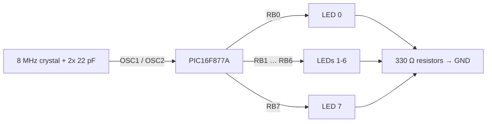
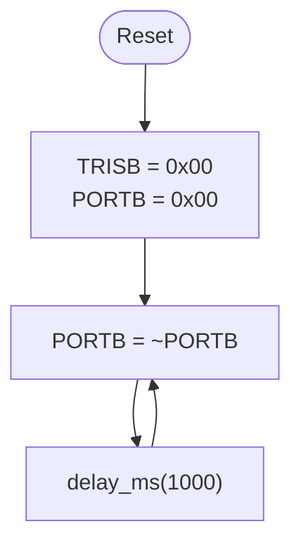

# Microcontroller-LED-Blinking

The first PIC16F877A exercises: driving LEDs on **PORTB** with software delays. The three sub-projects show three ways of toggling output pins: the whole port, single bits, and fast flashing.

## Target hardware & settings

| Setting | Value |
|---|---|
| Microcontroller | **PIC16F877A** (40-pin DIP, 8K words flash, 368 B RAM) |
| Clock | 8 MHz crystal, HS mode (`LED 1` is set to **10 MHz**) |
| Compiler / IDE | mikroC PRO for PIC |
| Config word | `0x2F4A`: HS oscillator, Watchdog **off**, Power-up timer **off**, Brown-out reset **on**, Low-voltage programming **off**, no code protection |

## Wiring

Each PORTB pin drives an LED through a series resistor to ground (active-high).

## Sub-projects

### `LED 1/`: toggle the whole port every second
- `TRISB = 0` makes all of PORTB an output, and `PORTB = 0` starts with every LED off.
- In the endless loop, `PORTB = ~PORTB` inverts all 8 pins at once, followed by `delay_ms(1000)`.
- **Result:** all 8 LEDs blink together, 1 s on and 1 s off.
- Project clock is set to 10 MHz, so `delay_ms` is calculated for a 10 MHz crystal.

### `Project1/`: single-bit control
- Uses bit access (`portb.f0`, `portb.f7`) instead of writing the whole port.
- The loop sets RB0 high, waits 1 s, then clears RB7 and waits 1 s.
- **Result:** RB0 turns on and stays on. RB7 is never set, so it stays off. It's an example of addressing individual pins.

### `bitwise/`: fast flashing
- Writes `0xFF` (all on), waits 50 ms, then writes `0x00` (all off) and waits 50 ms.
- **Result:** all LEDs flash at about 10 Hz. The unused `short ra = 0xff` was left over from experimenting with bitwise operators.

## Program flow (`LED 1`)

## Build & flash
1. Open the `.mcppi` file of a sub-project in **mikroC PRO for PIC**.
2. **Build** (Ctrl+F9). A ready-made `.hex` is already included.
3. Flash the `.hex` with a PICkit or another PIC programmer.

> The `.mcppi` files still contain search paths from the original PC (`D:\Mikro Projects\...`). These don't stop the build.
